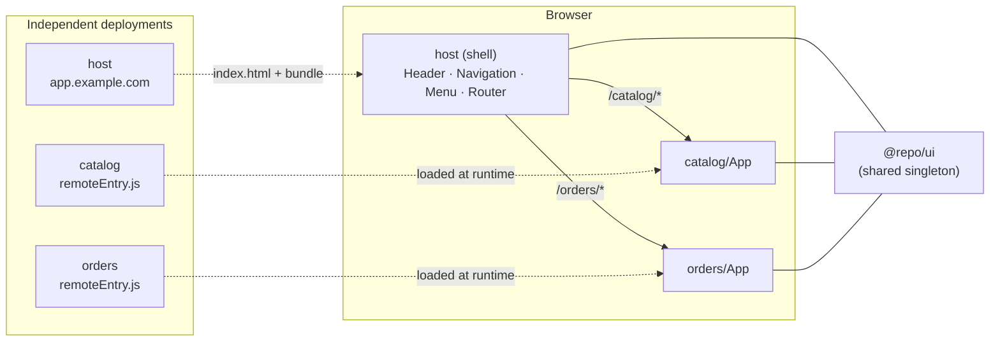
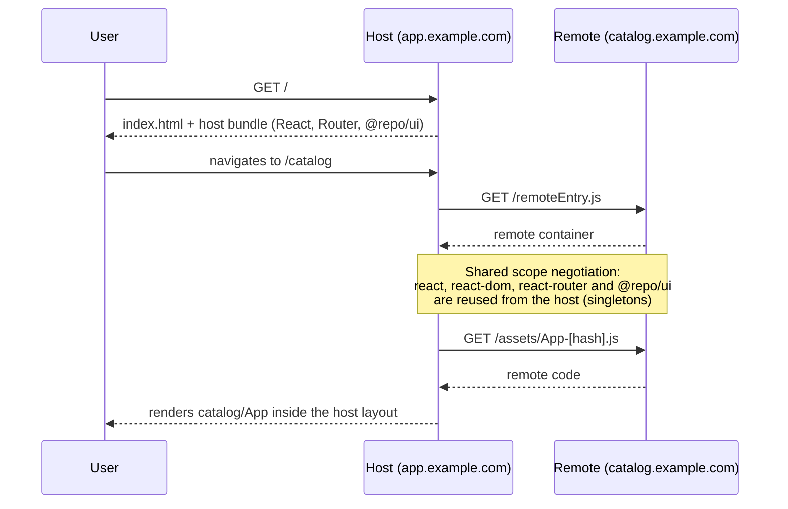
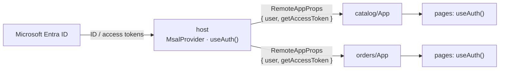

# Federation — React micro frontends

A **pnpm + Turborepo** monorepo for a React micro frontend application, built with **Vite** and
[`@module-federation/vite`](https://github.com/module-federation/vite).

A **host** application (the shell) provides the layout (header, navigation, side menu) and loads
independently built and deployed **remote** applications at runtime. All applications share a
React component library.

## Table of contents

- [Tech stack](#tech-stack)
- [Repository structure](#repository-structure)
- [Getting started](#getting-started)
- [Architecture](#architecture)
  - [Overview](#overview)
  - [Roles of each workspace](#roles-of-each-workspace)
  - [Runtime loading sequence](#runtime-loading-sequence)
  - [Shared dependencies](#shared-dependencies)
  - [Styling (Tailwind CSS + shadcn/ui)](#styling-tailwind-css--shadcnui)
  - [Shared UI library (shadcn/ui)](#shared-ui-library-shadcnui)
  - [Routing](#routing)
  - [Fault isolation](#fault-isolation)
  - [Authentication (MSAL)](#authentication-msal)
  - [Typing remote modules](#typing-remote-modules)
  - [Turborepo vs Module Federation](#turborepo-vs-module-federation)
- [Creating a new micro frontend](#creating-a-new-micro-frontend)
- [Deployment](#deployment)
- [Known limitations](#known-limitations)

## Tech stack

| Tool | Role |
| --- | --- |
| [pnpm](https://pnpm.io) workspaces | Package manager, links workspace packages together |
| [Turborepo](https://turborepo.com) | Task orchestration (`dev`, `build`, `typecheck`…) and caching |
| [Vite](https://vite.dev) | Dev server and bundler for each app |
| [`@module-federation/vite`](https://github.com/module-federation/vite) | Runtime composition of independently deployed apps |
| [React](https://react.dev) + [React Router](https://reactrouter.com) | UI and client-side routing |
| [Tailwind CSS v4](https://tailwindcss.com) (`@tailwindcss/vite`) | Styling |
| [shadcn/ui](https://ui.shadcn.com) (Base UI primitives, Lucide icons) | Shared UI components and theme in `@repo/ui` |
| [MSAL](https://learn.microsoft.com/entra/identity-platform/msal-overview) (`@azure/msal-browser`, `@azure/msal-react`) | Microsoft Entra ID sign-in, in the host only |
| [TypeScript](https://www.typescriptlang.org) | Type checking |

## Repository structure

```
.
├── apps/
│   ├── host/                    # Shell application — port 5000
│   │   ├── public/
│   │   │   └── redirect.html        # MSAL redirect bridge (static, registered in Entra ID)
│   │   ├── src/
│   │   │   ├── auth/
│   │   │   │   ├── msal.ts          # MSAL configuration and instance
│   │   │   │   └── useAuth.ts       # user, getAccessToken, signIn, signOut
│   │   │   ├── components/
│   │   │   │   ├── Header.tsx       # Brand + top navigation + user menu
│   │   │   │   ├── Navigation.tsx   # Horizontal top-level links
│   │   │   │   ├── Menu.tsx         # Collapsible side menu
│   │   │   │   ├── UserMenu.tsx     # Sign-in button or signed-in user's menu
│   │   │   │   └── RemoteRoute.tsx  # Suspense + ErrorBoundary wrapper, passes the user to remotes
│   │   │   ├── pages/               # Host-owned pages (Home, Settings, Sign in, 404)
│   │   │   ├── App.tsx              # Layout + routes, lazy-loads remotes
│   │   │   ├── index.css            # Tailwind entry (preflight + utilities + @repo/ui theme)
│   │   │   ├── navigation.ts        # Single source of truth for nav items
│   │   │   └── remotes.d.ts         # Type declarations for remote modules
│   │   ├── .env                     # Entra ID client and tenant IDs (public values)
│   │   ├── .env.example             # Remote URLs
│   │   └── vite.config.ts           # Declares the remotes
│   ├── catalog/                 # Remote micro frontend — port 5001
│   │   ├── src/
│   │   │   ├── App.tsx              # Exposed as `catalog/App`, receives RemoteAppProps
│   │   │   ├── app.css              # Tailwind utilities shipped with ./App (no preflight)
│   │   │   ├── auth.ts              # AuthContext + useAuth() for the remote's pages
│   │   │   ├── main.tsx             # Standalone entry point
│   │   │   ├── standalone.css       # Preflight, standalone mode only
│   │   │   ├── standaloneAuth.ts    # Placeholder user for standalone mode
│   │   │   └── pages/
│   │   └── vite.config.ts           # Exposes ./App
│   └── orders/                  # Remote micro frontend — port 5002 (same layout as catalog)
├── packages/
│   ├── auth/                    # @repo/auth — types only: AuthUser, RemoteAppProps (host ⇄ remotes contract)
│   └── ui/                      # @repo/ui — shadcn/ui workspace
│       ├── components.json          # shadcn CLI configuration
│       └── src/
│           ├── components/          # shadcn components (button, card…) + custom ones
│           ├── hooks/
│           ├── lib/utils.ts         # cn() helper
│           ├── styles/theme.css     # shadcn theme (CSS variables, no preflight)
│           └── index.ts             # Public API — the only entry apps import
├── pnpm-workspace.yaml
├── tsconfig.base.json           # Shared TypeScript options
└── turbo.json                   # Turborepo task pipeline
```

## Getting started

Prerequisites: Node.js 22+ and pnpm (the version is pinned in the root `package.json` → `packageManager`).

```sh
pnpm install
pnpm dev
```

| URL | Application |
| --- | --- |
| http://localhost:5000 | Host (with catalog and orders loaded inside) |
| http://localhost:5001 | Catalog, standalone |
| http://localhost:5002 | Orders, standalone |

| Command | Description |
| --- | --- |
| `pnpm dev` | Start all apps in dev mode (in parallel) |
| `pnpm build` | Production build of all apps (cached by Turborepo) |
| `pnpm preview` | Build, then serve the production bundles on the same ports |
| `pnpm typecheck` | Type-check every package |
| `pnpm clean` | Remove build outputs |
| `pnpm --filter <app> dev` | Run a single app, e.g. `pnpm --filter orders dev` |

## Architecture

### Overview



There are two levels of composition:

- **Build time (monorepo):** all apps live in one repository and share `@repo/ui`, TypeScript
  settings and a single lockfile, so dependency versions stay aligned.
- **Runtime (Module Federation):** each app is built and deployed **independently**. The host
  downloads a remote's `remoteEntry.js` only when the user navigates to it. Redeploying a remote
  updates the host **without rebuilding the host**.

### Roles of each workspace

| Workspace | Type | Responsibilities |
| --- | --- | --- |
| `apps/host` | Host / shell | Global layout (`Header`, `Navigation`, `Menu`), top-level routing, host-owned pages, loads remotes. Declares the remotes in `federation({ remotes })`. |
| `apps/catalog`, `apps/orders` | Remotes | Own a business domain. Expose `./App` through `federation({ exposes })`. Also run **standalone** through their own `main.tsx`. |
| `packages/ui` | Library | shadcn/ui components (`Button`, `Card`, `Badge`, `Input`, `Table`, `Popover`, `Command`, `Toggle`, `Spinner`…), custom shared components (`ErrorBoundary`, `DataTable`), the `cn()` class helper and the shared theme (`styles/theme.css`). Consumed **from source** (`exports` points to `src/index.ts`), so it has no build step. |

Each remote has **two entry points**:

| Entry point | Used when | Provides |
| --- | --- | --- |
| `src/main.tsx` | The app runs standalone (`http://localhost:5001`) | Its own `BrowserRouter`, the CSS reset (`standalone.css`) and a minimal page around `App` |
| `src/App.tsx` (exposed `./App`) | The app is loaded by the host | Only the routes, pages and their styles (`app.css`); the router comes from the host |

### Runtime loading sequence



### Shared dependencies

The `shared` section must be **identical in the host and in every remote**:

```ts
shared: {
  react: { singleton: true },
  "react-dom": { singleton: true },
  "react-router": { singleton: true },
  "@repo/ui": { singleton: true },
},
```

- `react` / `react-dom` **must** be singletons. Two copies of React cause `Invalid hook call` errors.
- `react-router` must be a singleton so that a remote's `<Routes>` uses the host's router context.
- `@repo/ui` is shared so that its components are loaded once.

### Styling (Tailwind CSS + shadcn/ui)

Styling uses [Tailwind CSS v4](https://tailwindcss.com) through the `@tailwindcss/vite` plugin, which
is registered in every app's `vite.config.ts`. There is no `tailwind.config.js`: configuration is
CSS-first. Shared components come from [shadcn/ui](https://ui.shadcn.com) (style `base-nova`, built
on [Base UI](https://base-ui.com) primitives, icons from [Lucide](https://lucide.dev)).

**Shared theme.** [`packages/ui/src/styles/theme.css`](packages/ui/src/styles/theme.css) is the shadcn
theme: CSS variables in `:root` and `.dark` (`--background`, `--primary`, `--muted-foreground`,
`--radius`…), mapped to Tailwind with `@theme inline`. It also imports `tw-animate-css`,
`shadcn/tailwind.css` and the Geist font, and contains `@source "../"`, so every app that imports it
also scans the `@repo/ui` components and generates the classes they use. Unlike shadcn's default
`globals.css`, it does **not** import `tailwindcss` (see below).

| Purpose | Utilities |
| --- | --- |
| Page / text | `bg-background`, `text-foreground` |
| Secondary text | `text-muted-foreground` |
| Surfaces | `bg-card`, `bg-popover`, `bg-muted`, `bg-accent`, `bg-sidebar` |
| Brand / actions | `bg-primary text-primary-foreground`, `bg-secondary`, `bg-destructive` |
| Borders and focus | `border-border` (default on `*`), `border-input`, `ring-ring` |
| Radius | `rounded-sm` … `rounded-4xl` (derived from `--radius`) |

To change the look (colors, radius, dark mode), edit the variables in `theme.css`, for example with a
theme generated on [ui.shadcn.com/themes](https://ui.shadcn.com/themes). Dark mode is enabled by
adding the `dark` class on an ancestor element (`@custom-variant dark`).

**CSS entry points.** Each app generates its own CSS from the classes found in its sources:

| File | Imports | Loaded by |
| --- | --- | --- |
| `apps/host/src/index.css` | `tailwindcss` (preflight + utilities) + `@repo/ui/theme.css` | `main.tsx` of the host |
| `apps/<remote>/src/app.css` | Tailwind theme + utilities only + `@repo/ui/theme.css` | the exposed `App.tsx`, so it ships with the remote |
| `apps/<remote>/src/standalone.css` | Tailwind preflight only | the remote's `main.tsx` (standalone mode only) |

Remotes do **not** ship the preflight (CSS reset) with their exposed module: inside the host, the
host's preflight already applies, and a second reset injected later could override host styles.
All files declare the same cascade layer order (`theme, base, components, utilities`), so utilities
from the host and from remotes never conflict, even when a class is generated twice.

**Class merging.** Use `cn()` from `@repo/ui` to combine classes. It resolves conflicting Tailwind
utilities, so a `className` passed to a component overrides its defaults:

```tsx
<Button className="px-8">Wide button</Button>   // px-8 replaces the default px-2.5
```

### Shared UI library (shadcn/ui)

`packages/ui` is a shadcn workspace. Its [`components.json`](packages/ui/components.json) tells the
shadcn CLI where to put files, through package-local
[subpath imports](https://nodejs.org/api/packages.html#subpath-imports) declared in its
`package.json`:

| Alias | Folder |
| --- | --- |
| `#components/*` | `src/components/*.tsx` |
| `#lib/*` | `src/lib/*.ts` (`cn()` in `utils.ts`) |
| `#hooks/*` | `src/hooks/*.ts` |

**Adding a shadcn component:**

```sh
pnpm --filter @repo/ui ui:add dialog       # runs `shadcn add dialog` inside packages/ui
```

Then export it from [`packages/ui/src/index.ts`](packages/ui/src/index.ts):

```ts
export { Dialog, DialogContent, DialogTitle /* … */ } from "#components/dialog";
```

and use it in any app:

```tsx
import { Dialog, DialogContent } from "@repo/ui";
```

> **Import from `@repo/ui` only.** Module Federation shares the `@repo/ui` entry as a singleton.
> Deep imports such as `@repo/ui/components/button` are not exported, because they would not be
> shared and each app would load its own copy.

Generated files can be edited freely: they are your code. Custom (non-shadcn) components, such as
`ErrorBoundary`, also live in `src/components` and are exported the same way.

Current components: `Button`, `Card` (`CardHeader`, `CardTitle`, `CardDescription`, `CardAction`,
`CardContent`, `CardFooter`), `Badge`, `Input`, `InputGroup`, `Textarea`, `Table` (`TableHeader`,
`TableBody`, `TableRow`, `TableHead`, `TableCell`…), `Popover`, `Command` (cmdk), `Dialog`, `Toggle`,
`Separator`, `Spinner` (shadcn), `ErrorBoundary` (custom) and `DataTable` (custom, built on `Table`
and [TanStack Table](https://tanstack.com/table) v9 following shadcn's data-table guide).

`DataTable` provides sorting, a global search (`filterPlaceholder`) and pagination. Define columns
with the `DataTableColumnDef<TData>` type and use `DataTableColumnHeader` for sortable headers, as in
`apps/catalog/src/pages/ProductList.tsx`. `@tanstack/react-table` is a dependency of `@repo/ui` only:
apps never import it directly.

Rows are plain by default. Expansion is opt-in, and `DataTable` then adds a chevron column:

- `renderSubComponent={(row) => …}`: detail panel rendered under an expanded row.
  `getRowCanExpand` restricts which rows can expand.
- `getSubRows={(row) => row.children}`: tree data, where sub-rows have the same type as their parent
  (catalog example: product `variants`). Nested rows are indented, the header gets an "expand all"
  button, and searching keeps the parents of matching sub-rows and expands them.

Column filters are opt-in with `enableColumnFilters`. A "Filters" toggle (showing the number of
active filters) displays a filter button in every filterable header (accessor columns, unless
`enableColumnFilter: false`). It opens a dropdown listing the column's distinct values with their
counts, with a search input to narrow the list; selecting several values keeps rows matching any of
them. Hiding the filters clears them. Set `meta` on a column to control the dropdown:
`filterTitle` (name shown in the dropdown) and `filterLabel` (value label, e.g.
`(inStock) => (inStock ? "In stock" : "Out of stock")`).

### Routing

- The host mounts each remote under a wildcard route: `<Route path="orders/*" … />`.
- Remotes declare **relative** routes only (`index`, `":orderId"`) and navigate relatively
  (`navigate(id)`, `navigate("..", { relative: "path" })`).
- Never hard-code the mount path (`/orders/...`) inside a remote. The same code works at `/` when
  standalone and at `/orders` inside the host.
- Navigation items are defined once in [`apps/host/src/navigation.ts`](apps/host/src/navigation.ts)
  and rendered by both `Navigation` (header) and `Menu` (sidebar).

### Fault isolation

Remotes are rendered through [`RemoteRoute`](apps/host/src/components/RemoteRoute.tsx):

```tsx
const OrdersApp = lazy(() => import("orders/App"));

<Route path="orders/*" element={<RemoteRoute name="Orders" component={OrdersApp} />} />
```

`RemoteRoute` wraps the remote in:

- `Suspense`, which shows a spinner while `remoteEntry.js` and the remote's chunks download;
- `ErrorBoundary` (from `@repo/ui`), which shows "*Orders is unavailable*" with a **Retry** button if
  the remote cannot be loaded or throws. The header, menu and other remotes keep working.

### Authentication (MSAL)

The **host** signs users in with Microsoft Entra ID through MSAL (`@azure/msal-browser` +
`@azure/msal-react`). **Remotes never use MSAL**: they receive the signed-in user from the host as
props of their exposed `App`.



**Contract.** [`@repo/auth`](packages/auth/src/index.ts) is a **types-only** package shared by the
host and the remotes:

```ts
interface AuthUser { id: string; name: string; username: string; tenantId: string; roles: string[] }
type GetAccessToken = (scopes: string[]) => Promise<string>;
interface RemoteAppProps { user: AuthUser; getAccessToken: GetAccessToken }
```

It has no runtime code, so it is **not** part of Module Federation's `shared` config.

**Host:**

- [`auth/msal.ts`](apps/host/src/auth/msal.ts) configures MSAL with the authority
  `https://login.microsoftonline.com/<tenant>` and the redirect URI `<host URL>/redirect.html`. It
  initializes the instance before rendering and keeps the active account up to date.
- [`auth/useAuth.ts`](apps/host/src/auth/useAuth.ts) returns `user` (mapped from the ID token
  claims), `getAccessToken` (`acquireTokenSilent`, falling back to `acquireTokenRedirect`), `signIn`
  and `signOut`. Both sign-in and sign-out use redirects.
- [`App.tsx`](apps/host/src/App.tsx) renders the routes inside `AuthenticatedTemplate`, and a sign-in
  page inside `UnauthenticatedTemplate`. The header shows a **Sign in** button or the user's menu.
- [`RemoteRoute`](apps/host/src/components/RemoteRoute.tsx) passes `user` and `getAccessToken` to
  every remote.

**Remotes:** the exposed `App` puts its props into a remote-local `AuthContext`
([`auth.ts`](apps/catalog/src/auth.ts)), so any page can call `useAuth()`. In standalone mode,
`main.tsx` passes a placeholder user ([`standaloneAuth.ts`](apps/catalog/src/standaloneAuth.ts)), and
`getAccessToken` rejects.

```tsx
// In a remote page
const { user, getAccessToken } = useAuth();
const token = await getAccessToken(["api://<api-client-id>/access_as_user"]);
```

**Redirect bridge (MSAL v5).** Microsoft Entra ID sends `Cross-Origin-Opener-Policy` headers, so MSAL v5
returns the authentication response through a minimal **redirect bridge** page:
[`apps/host/public/redirect.html`](apps/host/public/redirect.html). It lives in `public/` on purpose:
Vite and the Module Federation plugin would otherwise inject the host bundle and the remotes into it.
It loads `redirect-bridge.js`, the standalone bridge script shipped with `@azure/msal-browser`. The
`msalRedirectBridge()` plugin in the host's `vite.config.ts` serves that script in dev and emits it
in the build.

**Configuration.**

- [`apps/host/.env`](apps/host/.env) holds `VITE_MSAL_CLIENT_ID` and `VITE_MSAL_TENANT_ID`. These are
  public identifiers, not secrets. Override them in `.env.local`.
- The app registration (single tenant) must list these redirect URIs under
  **Authentication → Single-page application**:
  - `http://localhost:5000/redirect.html` (dev and `pnpm preview`)
  - `https://<owner>.github.io/<repo>/redirect.html` (GitHub Pages)
- Sign-in requests the `User.Read` scope (`loginRequest` in `msal.ts`).

### Typing remote modules

`import("orders/App")` is not a real package. It is resolved **at runtime** by Module Federation, so
TypeScript cannot find it on its own. [`apps/host/src/remotes.d.ts`](apps/host/src/remotes.d.ts)
declares each exposed module:

```ts
declare module "orders/App" {
  import type { ComponentType } from "react";
  import type { RemoteAppProps } from "@repo/auth";
  const App: ComponentType<RemoteAppProps>;
  export default App;
}
```

This file only affects type checking and has no runtime effect. It is a hand-written contract: keep
it in sync with what the remote really exposes. Alternatives are the Module Federation type
generation (`dts: true`) or a `tsconfig` `paths` alias to the remote's sources.

### Turborepo vs Module Federation

They solve different problems and complement each other:

| | Module Federation | Turborepo |
| --- | --- | --- |
| When | **Runtime**, in the browser | **Development / CI** |
| Purpose | Compose separately deployed bundles into one app | Run tasks across workspaces in the right order, with caching |
| Configured in | each `vite.config.ts` | `turbo.json` |
| Shipped to production | Yes (runtime in the bundle) | No |

Turborepo provides `pnpm dev` across all apps, build caching (keyed on env vars such as
`REMOTE_BASE_URL`), and affected-only builds in CI (`turbo run build --filter=...[origin/main]`).

## Creating a new micro frontend

The example below adds an app called **`billing`** on **port 5003**, mounted at **`/billing/*`**.

> **Naming rule:** the federation `name` must be a valid JavaScript identifier, with no dashes
> (`billing` or `userProfile`, not `user-profile`). It is used as a global container name.

### 1. Copy an existing remote

```powershell
robocopy apps\orders apps\billing /E /XD node_modules dist .turbo .__mf__temp
```

```sh
# macOS / Linux
rsync -a --exclude node_modules --exclude dist --exclude .turbo --exclude .__mf__temp apps/orders/ apps/billing/
```

### 2. Rename it and assign a port

`apps/billing/package.json`:

```json
"name": "billing",
```

`apps/billing/vite.config.ts`:

```ts
const PORT = 5003;
// ...
federation({
  name: "billing",
  filename: "remoteEntry.js",
  manifest: true,
  exposes: {
    "./App": "./src/App.tsx",
  },
  shared: { /* keep identical to the host */ },
  dts: false,
}),
```

`apps/billing/index.html`: update the `<title>`.

### 3. Implement the app

- `src/App.tsx`: the exposed component. It receives `RemoteAppProps` (`user`, `getAccessToken`)
  and provides them through `AuthContext`. Declare **relative** routes only. Keep the
  `import "./app.css"` at the top, so that the remote's styles ship with it.
- `src/main.tsx`: the standalone entry. Keep the `BrowserRouter` +
  `<Route path="/*" element={<App user={standaloneUser} getAccessToken={standaloneGetAccessToken} />} />`
  wrapper and the `import "./standalone.css"`, and update the label.
- Pages read the signed-in user with `useAuth()` from `src/auth.ts`.
- Replace `src/data.ts` and `src/pages/*` with your own code. Style with Tailwind utility classes
  and the theme tokens, and use `@repo/ui` components for a consistent look.

### 4. Register the remote in the host

`apps/host/vite.config.ts`:

```ts
const billingUrl = env.VITE_BILLING_URL ?? "http://localhost:5003";
// ...
remotes: {
  // ...existing remotes
  billing: {
    type: "module",
    name: "billing",
    entry: `${billingUrl}/remoteEntry.js`,
    entryGlobalName: "billing",
    shareScope: "default",
  },
},
```

`apps/host/src/remotes.d.ts`:

```ts
declare module "billing/App" {
  import type { ComponentType } from "react";
  import type { RemoteAppProps } from "@repo/auth";
  const App: ComponentType<RemoteAppProps>;
  export default App;
}
```

`apps/host/src/App.tsx`:

```tsx
const BillingApp = lazy(() => import("billing/App"));
// ...
<Route path="billing/*" element={<RemoteRoute name="Billing" component={BillingApp} />} />
```

`apps/host/src/navigation.ts`:

```ts
{ to: "/billing", label: "Billing", icon: "💳" },
```

### 5. Declare the environment variable

- `turbo.json`: add `"VITE_BILLING_URL"` to `tasks.build.env` so that the build cache depends on it.
- `apps/host/.env.example`: add `VITE_BILLING_URL=http://localhost:5003`.

### 6. Install and verify

```sh
pnpm install
pnpm typecheck
pnpm dev
```

Checklist:

- [ ] http://localhost:5003 and its sub-routes work **standalone**.
- [ ] http://localhost:5000/billing and its sub-routes work **inside the host**, and the header and menu links are active.
- [ ] Stopping the billing dev server shows "*Billing is unavailable*" in the host without breaking other pages.
- [ ] No `Invalid hook call` error in the console. If there is one, the `shared` config differs between the host and the remote.
- [ ] `pnpm build` succeeds.

### 7. Set up deployment

Create a dedicated CI pipeline for the new app (see [Deployment](#deployment)), and rebuild the host
**once** with `VITE_BILLING_URL` pointing to the production URL.

For GitHub Pages: copy `.github/workflows/deploy-orders.yml` to `deploy-billing.yml` and change the
name, the paths filter, `app: billing` and `target: mfe/billing`. Add a `billing` job to
`deploy-all.yml`, before `host`. In `_deploy-app.yml`, add
`echo "VITE_BILLING_URL=${site}mfe/billing" >> "$GITHUB_ENV"` to the *Compute public URLs* step.

## Deployment

Each app builds to **static files** (`apps/<app>/dist`) and is deployed **independently** to any
static hosting service (Azure Static Web Apps, Azure Storage + Front Door, S3 + CloudFront, Nginx…).
`@repo/ui` is bundled into the apps and is not deployed.

### Build-time environment variables

| Variable | App | Description | Default |
| --- | --- | --- | --- |
| `REMOTE_BASE_URL` | each remote | Public URL of the remote, **with** trailing slash. Used as Vite `base` so that asset URLs are absolute and resolve from the host origin. | `http://localhost:<port>/` |
| `HOST_BASE_URL` | host | Public path of the host (Vite `base`), **with** trailing slash, e.g. `/federation/` | `/` |
| `VITE_CATALOG_URL` | host | URL of the catalog remote, **without** trailing slash | `http://localhost:5001` |
| `VITE_ORDERS_URL` | host | URL of the orders remote, **without** trailing slash | `http://localhost:5002` |
| `VITE_MSAL_CLIENT_ID`, `VITE_MSAL_TENANT_ID` | host | Microsoft Entra ID app registration | set in `apps/host/.env` |

Every app derives its router `basename` from its Vite `base` (`import.meta.env.BASE_URL`), so apps
work both at the domain root and under a sub-path.

```sh
REMOTE_BASE_URL=https://orders.example.com/ pnpm turbo run build --filter=orders
VITE_CATALOG_URL=https://catalog.example.com VITE_ORDERS_URL=https://orders.example.com \
  pnpm turbo run build --filter=host
```

### Hosting requirements

| Requirement | Applies to | Why |
| --- | --- | --- |
| CORS: `Access-Control-Allow-Origin: <host origin>` | remotes | The host loads the remotes' files from another origin |
| `Cache-Control: no-cache` on `remoteEntry.js`, `mf-manifest.json` and `index.html` | all apps | These files are not content-hashed. Without it, users keep stale versions. |
| `Cache-Control: max-age=31536000, immutable` on `assets/*` | all apps | Hashed files can be cached forever |
| SPA fallback to `index.html` | all apps | Client-side routing (`BrowserRouter`) |

Serving all apps behind a single domain through a reverse proxy (for example `/` for the host and
`/mfe/orders/` for orders) removes the need for CORS.

### CI/CD

Use one pipeline per app, triggered only when the app or one of its dependencies changed:

```yaml
- run: pnpm install --frozen-lockfile
- run: pnpm turbo run build --filter=orders...[origin/main]
  env:
    REMOTE_BASE_URL: https://orders.example.com/
- run: # upload apps/orders/dist to the hosting service
```

A remote redeployed at the same URL goes live in the host immediately. Rolling back means
redeploying the previous `dist`.

### GitHub Pages

GitHub Actions workflows in [`.github/workflows`](.github/workflows) publish every app to GitHub
Pages, **independently**, on a single site:

| Path | App |
| --- | --- |
| `https://<owner>.github.io/<repo>/` | host (+ `404.html` SPA fallback) |
| `https://<owner>.github.io/<repo>/mfe/catalog/` | catalog (also usable standalone) |
| `https://<owner>.github.io/<repo>/mfe/orders/` | orders (also usable standalone) |

All apps share one origin, so no CORS is needed.

| Workflow | Trigger | Deploys |
| --- | --- | --- |
| `deploy-host.yml` | push to `main` touching `apps/host/**`, `packages/**`, the lockfile or `turbo.json`; manual | host |
| `deploy-catalog.yml` | same, for `apps/catalog/**`; manual | catalog |
| `deploy-orders.yml` | same, for `apps/orders/**`; manual | orders |
| `deploy-all.yml` | manual only | catalog, orders, then host |
| `_deploy-app.yml` | reusable, called by the others | — |

Each run:

1. computes the URLs (`HOST_BASE_URL`, `REMOTE_BASE_URL`, `VITE_*_URL`) from the repository name;
2. runs `turbo run typecheck build --filter=<app>`;
3. pushes the app's `dist` to its folder of the `gh-pages` branch with
   [`peaceiris/actions-gh-pages`](https://github.com/peaceiris/actions-gh-pages) and `keep_files: true`,
   so the other apps' files are kept. It also writes `.nojekyll`, because federation chunks start with `_`
   and Jekyll would drop them.

Pushes are serialized with a `gh-pages` concurrency group.

**First-time setup:**

1. Push the repository to GitHub. The workflows trigger on `main`; adjust `branches` if your default
   branch differs.
2. **Settings → Actions → General → Workflow permissions**: allow *Read and write permissions*.
3. Run **Actions → Deploy all**. This creates the `gh-pages` branch.
4. **Settings → Pages → Build and deployment**: source *Deploy from a branch*, branch `gh-pages`, folder `/ (root)`.
5. Optional: set the repository variable `PAGES_BASE_URL` (e.g. `https://example.com/` for a custom
   domain, or `https://<owner>.github.io/` for a `<owner>.github.io` repository). It overrides the
   default `https://<owner>.github.io/<repo>/`. Run **Deploy all** again after changing it.

**GitHub Pages limitations:**

- GitHub Pages has no rewrites: deep links such as `/<repo>/orders/ORD-1002` are served by `404.html`
  (a copy of the host's `index.html`), with an HTTP 404 status. The app still renders normally.
- A deep link reloaded on a **standalone** remote (`/<repo>/mfe/catalog/keyboard`) also gets the host's
  `404.html`, so the host's "not found" page shows. Remote standalone pages work from their root URL.
- Cache headers cannot be configured: GitHub Pages serves every file with `max-age=600`, so a redeployed
  remote can take up to 10 minutes to reach users.
- Old hashed assets are never removed from `gh-pages`, because files are kept between deployments. Clean the
  branch manually if it grows too large.
- At most one deployment runs and one waits in the `gh-pages` concurrency group. If more are queued, the
  older pending run is cancelled. Re-run it, or use **Deploy all**.

## Known limitations

- **Remote URLs are fixed at build time.** The host bakes `VITE_*_URL` into its bundle, so you need
  one host build per environment. To promote the same artifact across environments, register remotes
  at startup from a runtime `config.json` with `registerRemotes()` from `@module-federation/runtime`.
- **`@repo/ui` singleton versioning.** All apps declare `@repo/ui@0.0.0`, so the copy loaded first,
  the host's, wins. A UI change deployed with a remote only does not show up until the host is
  redeployed. Either bump the `@repo/ui` version on each change (for example with Changesets), or
  remove it from `shared` so that each app bundles its own copy.
- **Major upgrades** of React or React Router must be rolled out to the host and all remotes together.
- **Remote types are hand-written** in `remotes.d.ts` and can drift from the actual exposed modules
  (see [Typing remote modules](#typing-remote-modules)).
